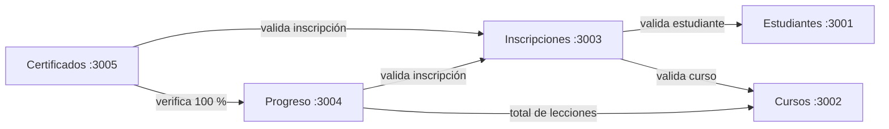

# 🎓 mini-Udemy — Plataforma de cursos con microservicios

**Curso:** Cloud Computing — Universidad Continental
**Producto académico N.º 3** — Actividad grupal

## 👥 Integrantes

| Integrante | Rol | Microservicio a cargo | Usuario GitHub |
|------------|-----|-----------------------|----------------|
| Nombre Apellido 1 | **Líder** (administra el repo y revisa los PR) | Estudiantes | @JhimyMc |
| Nombre Apellido 2 | Desarrollador | Cursos | @LUIS CRISTIAN |
| Nombre Apellido 3 | Desarrollador | Inscripciones | @Daniel |
| Nombre Apellido 4 | Desarrollador | Progreso | @Andree |
| Nombre Apellido 5 | Desarrollador | Certificados | @Urpi R |

---

# PARTE 1 — Concepción del proyecto

## 1.1 Contexto y problemática

**Lugar:** Región **Cusco, Perú**, especialmente las provincias fuera de la ciudad (por ejemplo Quispicanchi, Canchis o Espinar).

**Problemática:** Muchos jóvenes de estas provincias quieren capacitarse en oficios y habilidades digitales (ofimática, turismo, emprendimiento, idiomas) para mejorar sus oportunidades de trabajo. Sin embargo:

- Los institutos y la oferta de cursos se concentran en la ciudad del Cusco, y viajar cuesta tiempo y dinero.
- Las plataformas de cursos existentes suelen ser pesadas (videos largos, mucho consumo de datos) y están pensadas para computadoras y buena conexión.
- Cuando terminan un curso informal, no tienen una **constancia** que puedan mostrar a un empleador.

## 1.2 Condiciones reales de los usuarios

| Condición | Situación en el contexto | Cómo la considera la solución |
|-----------|--------------------------|-------------------------------|
| Acceso a Internet | Intermitente; mayormente datos móviles prepago | API ligera (respuestas JSON pequeñas); el progreso se guarda por lección, así no se pierde el avance si se corta la conexión |
| Dispositivos | Principalmente celulares Android de gama media/baja | Diseñada para consumirse desde un front-end móvil sencillo |
| Hábitos | Uso frecuente de WhatsApp y redes sociales desde el celular | Lecciones cortas que se pueden completar en pocos minutos |
| Adaptación tecnológica | Manejo básico del celular | Flujo simple: registrarse → inscribirse → avanzar → obtener certificado |

## 1.3 Usuarios objetivo

- **Estudiantes:** jóvenes y adultos de 16 a 35 años de las provincias de Cusco que buscan capacitarse.
- **Instructores / instituciones:** institutos locales, municipalidades u ONG que quieren publicar cursos cortos.
- **Empleadores:** pueden verificar el certificado emitido por la plataforma.

## 1.4 Propuesta de solución

**mini-Udemy** es una plataforma de cursos en línea en la que:

1. El estudiante se **registra** con su nombre y email.
2. Explora el **catálogo de cursos** (cada curso tiene un número de lecciones).
3. Se **inscribe** en un curso.
4. Marca su **progreso** lección por lección; el sistema calcula su porcentaje de avance.
5. Al llegar al **100 %**, obtiene un **certificado** con un código único que un empleador puede verificar.

La solución usa una **arquitectura de microservicios**: cada parte del sistema es independiente, tiene su propia base de datos y se comunica con las demás por HTTP. Si un servicio falla (por ejemplo, Certificados), el resto de la plataforma sigue funcionando.

## 1.5 Microservicios

| # | Microservicio | Puerto | Responsabilidad | Se comunica con |
|---|---------------|--------|-----------------|-----------------|
| 1 | **Estudiantes** | 3001 | Registrar y consultar estudiantes | — |
| 2 | **Cursos** | 3002 | Catálogo de cursos (título, instructor, número de lecciones) | — |
| 3 | **Inscripciones** | 3003 | Inscribir un estudiante en un curso | Estudiantes, Cursos |
| 4 | **Progreso** | 3004 | Registrar lecciones completadas y calcular el % de avance | Inscripciones, Cursos |
| 5 | **Certificados** | 3005 | Emitir el certificado cuando el progreso es 100 % | Inscripciones, Progreso |



**Tecnologías:** Node.js + Express, PostgreSQL (una base de datos por servicio), Docker, Docker Compose, Jest + Supertest y GitHub Actions.

---

# PARTE 2 — Repositorio y organización del equipo

- **Repositorio central:** https://github.com/JhimyMc/mini-Udemy
- **Líder:** @JhimyMc
- **Protección de `main`:** los cambios solo entran mediante **Pull Request** con **al menos 1 aprobación**.
- **Forks:** cada integrante trabaja en su propio fork y envía Pull Requests al repositorio central.

📸 *Captura: configuración de protección de la rama `main`*
<!--  -->

📸 *Captura: forks de los integrantes*
<!--  -->

### Flujo de trabajo

```bash
# 1. Clonar TU fork
git clone git@github.com:TU_USUARIO/mini-Udemy.git
cd mini-Udemy

# 2. Enlazar el repositorio central
git remote add upstream git@github.com:JhimyMc/mini-Udemy.git

# 3. Antes de empezar a trabajar, traer lo último del central
git pull upstream main

# 4. Trabajar en una rama
git checkout -b feature/nombre-del-cambio
git add .
git commit -m "Descripción clara del cambio"
git push origin feature/nombre-del-cambio

# 5. En GitHub: abrir un Pull Request hacia JhimyMc/mini-Udemy (main)
```

---

# PARTE 3 — Desarrollo del proyecto

## 3.1 Estructura del repositorio

```
mini-Udemy/
├── .github/workflows/ci.yml
├── estudiantes/
├── cursos/
├── inscripciones/
├── progreso/
├── certificados/
│   └── (cada uno con: src/, tests/, init.sql, Dockerfile, package.json)
├── docker-compose.yml
├── docs/capturas/
└── README.md
```

## 3.2 Endpoints

Todos los servicios tienen `GET /health` y un CRUD básico.

| Servicio | Endpoints |
|----------|-----------|
| Estudiantes | `GET /estudiantes` · `GET /estudiantes/:id` · `POST` · `PUT /:id` · `DELETE /:id` |
| Cursos | `GET /cursos` · `GET /cursos/:id` · `POST` · `PUT /:id` · `DELETE /:id` |
| Inscripciones | `GET /inscripciones` · `GET /inscripciones/:id` · `POST` (valida estudiante y curso) · `DELETE /:id` |
| Progreso | `POST /progreso` (marca una lección) · `GET /progreso/inscripcion/:id` → `{ "porcentaje": 75 }` |
| Certificados | `POST /certificados` (solo con 100 %) · `GET /certificados/:id` · `GET /certificados/codigo/:codigo` |

## 3.3 Reglas de negocio

| Regla | Servicio | Respuesta si no se cumple |
|-------|----------|---------------------------|
| El estudiante y el curso deben existir para inscribirse | Inscripciones | `400` |
| No se permite inscribir dos veces al mismo estudiante en el mismo curso | Inscripciones | `409` |
| Solo se registra progreso de inscripciones existentes | Progreso | `400` |
| El certificado solo se emite con el progreso al 100 % | Certificados | `400` |
| Solo un certificado por inscripción | Certificados | `409` |

📸 *Captura: servicios funcionando*
<!--  -->

## 3.4 Docker

Cada microservicio tiene su **Dockerfile** y su propia base de datos PostgreSQL. Todo se levanta junto con **Docker Compose**:

```bash
docker compose up -d --build
docker compose ps
curl http://localhost:3001/health
```

📸 *Captura: `docker compose ps` con los 10 contenedores (5 APIs + 5 bases de datos)*
<!--  -->

## 3.5 Pruebas

Las pruebas usan **Jest + Supertest** y se ejecutan dentro de cada contenedor:

```bash
docker compose exec estudiantes npm test
```

### Pruebas implementadas

| ID | Microservicio | Funcionalidad que verifica | Comportamiento esperado |
|----|---------------|----------------------------|-------------------------|
| E1 | Estudiantes | Estado del servicio (`GET /health`) | `200` y `servicio: "estudiantes"` |
| E2 | Estudiantes | Listar estudiantes | `200` y lista con al menos 1 registro |
| E3 | Estudiantes | Consultar un estudiante inexistente (`/9999`) | `404` "Estudiante no encontrado" |
| E4 | Estudiantes | Crear estudiante sin email | `400` |
| C1 | Cursos | Estado del servicio | `200` y `servicio: "cursos"` |
| C2 | Cursos | Consultar curso existente (`/1`) | `200` y `id = 1` |
| C3 | Cursos | Consultar curso inexistente | `404` |
| C4 | Cursos | Crear curso con número de lecciones inválido | `400` |
| I1 | Inscripciones | Inscripción válida | `201 Created` |
| I2 | Inscripciones | Inscribir un estudiante inexistente | `400` "El estudiante o curso no existe" |
| I3 | Inscripciones | Inscribir en un curso inexistente | `400` |
| I4 | Inscripciones | Inscripción duplicada | `409 Conflict` |
| P1 | Progreso | Registrar una lección de una inscripción válida | `201` |
| P2 | Progreso | Registrar progreso de una inscripción inexistente | `400` |
| P3 | Progreso | Calcular el porcentaje de avance | `200` y `porcentaje` entre 0 y 100 |
| X1 | Certificados | Pedir certificado con progreso incompleto | `400` "El curso no está completado" |
| X2 | Certificados | Pedir certificado con progreso al 100 % | `201` y código único |
| X3 | Certificados | Pedir el mismo certificado otra vez | `409 Conflict` |

📸 *Captura: resultados de `npm test` de cada servicio*
<!--  -->

## 3.6 Integración continua (GitHub Actions)

El archivo `.github/workflows/ci.yml` se ejecuta en cada **push** y cada **Pull Request** hacia `main`:

1. Descarga el código.
2. **Construye las imágenes Docker** de los 5 microservicios.
3. Levanta todo con Docker Compose.
4. Espera a que las 5 APIs respondan en `/health`.
5. **Ejecuta las pruebas** de cada microservicio.
6. Si algo falla, muestra los logs; al final detiene los contenedores.

| Situación | Resultado esperado |
|-----------|--------------------|
| Código correcto | ✅ Pipeline en verde |
| Se introduce un error (por ejemplo, una tabla mal escrita) | ❌ Pipeline en rojo indicando el test que falló |
| Se corrige el error | ✅ Vuelve a verde |

📸 *Captura: pipeline exitoso en la pestaña Actions*
<!--  -->

📸 *Captura: pipeline detectando un error*
<!--  -->

---

## 🤖 Uso de herramientas de IA

Usamos asistentes de IA como apoyo para generar la estructura inicial del código y de la documentación. Todo el contenido fue **revisado, probado y adaptado** por el equipo: cada integrante ejecutó las pruebas de su servicio y entiende el funcionamiento de su código.

---

## ▶️ Cómo ejecutar el proyecto

```bash
git clone https://github.com/JhimyMc/mini-Udemy.git
cd mini-Udemy
docker compose up -d --build

# Probar
curl http://localhost:3001/estudiantes
curl http://localhost:3002/cursos

# Pruebas
docker compose exec inscripciones npm test

# Detener
docker compose down
```
