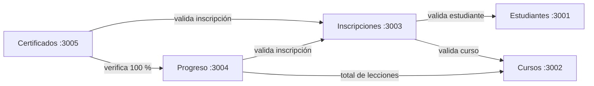

# 🎓 mini-Udemy — Plataforma de cursos con microservicios

**Curso:** Cloud Computing — Universidad Continental
**Producto académico N.º 3** — Actividad grupal

## 👥 Integrantes

| Integrante | Rol | Microservicio |
|------------|-----|---------------|
| @JhimyMc | Líder | Estudiantes |
| @Luis Cristian Rafaele Huaman | Desarrollador | Cursos |
| @Daniel Benjamin Quispirroca Benitez | Desarrollador | Inscripciones |
| @Edwards Andree Ochoa Cutipa | Desarrollador | Progreso |
| @Urpi Radhakrina Pilco Del Alamo | Desarrollador | Certificados |

## 📖 Introducción

En las provincias de la región **Cusco**, muchos jóvenes quieren capacitarse para conseguir mejores oportunidades de trabajo, pero la oferta de cursos se concentra en la ciudad, la conexión a Internet suele ser limitada y, al terminar un curso, no tienen una constancia que puedan mostrar a un empleador.

**mini-Udemy** es una plataforma de cursos en línea, ligera y pensada para usarse desde el celular, donde el estudiante:

1. Se registra.
2. Elige un curso y se inscribe.
3. Avanza lección por lección.
4. Al completar el 100 %, obtiene un **certificado** con un código único.

El sistema está construido con una **arquitectura de microservicios**: cada servicio es independiente, tiene su propia base de datos y se comunica con los demás por HTTP. Se ejecuta con **Docker Compose** y se valida automáticamente con **GitHub Actions**.

## 🧩 Microservicios

| Microservicio | Puerto | Responsabilidad | Se comunica con |
|---------------|--------|-----------------|-----------------|
| **Estudiantes** | 3001 | Registrar y consultar estudiantes | — |
| **Cursos** | 3002 | Catálogo de cursos y número de lecciones | — |
| **Inscripciones** | 3003 | Inscribir a un estudiante en un curso | Estudiantes, Cursos |
| **Progreso** | 3004 | Registrar lecciones completadas y calcular el % de avance | Inscripciones, Cursos |
| **Certificados** | 3005 | Emitir el certificado cuando el progreso llega al 100 % | Inscripciones, Progreso |

**Tecnologías:** Node.js + Express · PostgreSQL · Docker · Docker Compose · Jest + Supertest · GitHub Actions
